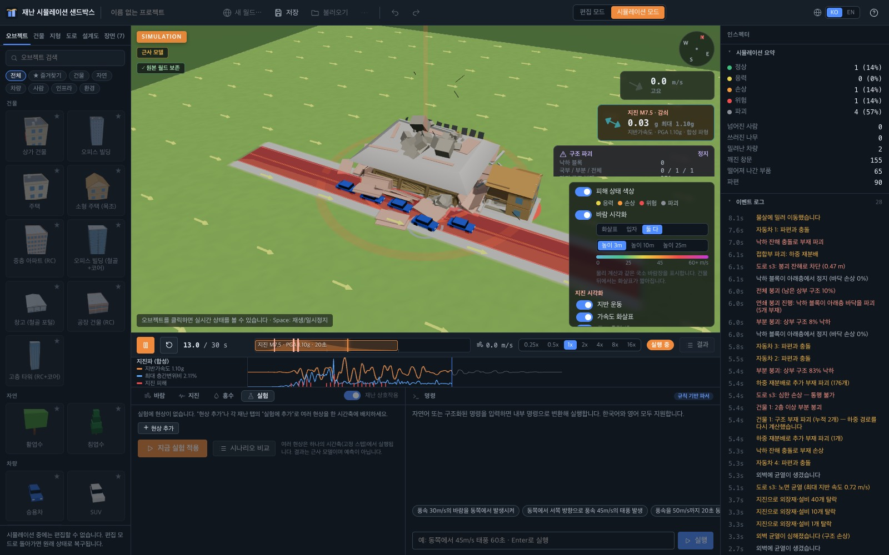
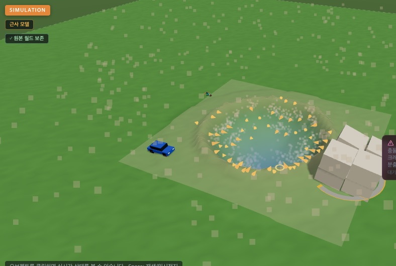
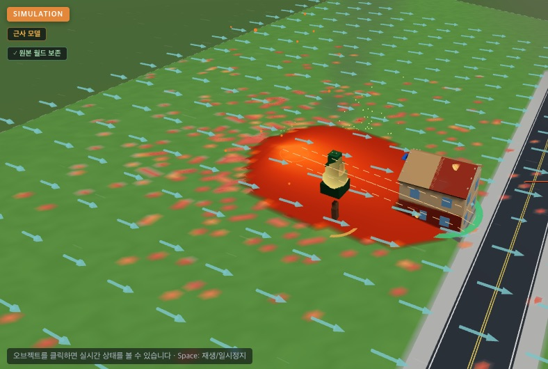
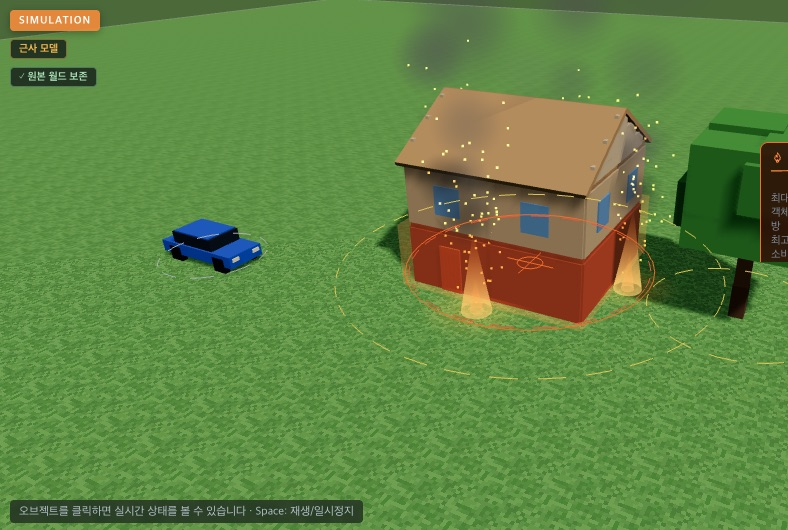
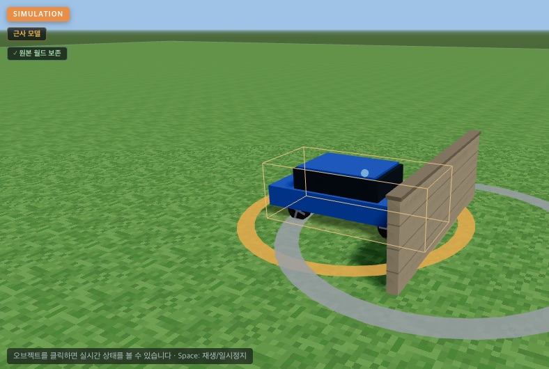

# 재난 시뮬레이션 샌드박스

마을을 직접 만들고 재난을 일으켜 어떻게 무너지는지 관찰하는, 브라우저용 3D 물리 실험실입니다.



## 목적과 사용자

재난이 건물·도로·사람에게 어떤 순서로 영향을 주는지 눈으로 확인하고 조건을 바꿔 비교하고 싶은 학습자와 시뮬레이션 애호가를 위한 프로젝트입니다.

**교육용 축약 모델입니다.** 어떤 모델도 측정값으로 검증되지 않았으며, 실제 피해 예측이나 안전 판단에 사용할 수 없습니다.

| 운석 충돌 | 용암류 |
|---|---|
|  |  |
| **건물 화재** | **차량 충돌** |
|  |  |

## 실행

확인한 환경: macOS(Apple Silicon), Node.js 24.21.0, npm 11.19.0, Chrome. 다른 환경은 확인하지 않았습니다.

```
npm install
npm run dev     # http://localhost:5173
npm test        # 전체 테스트(머신 부하에 따라 10분 이상 걸림)
npm run build
```

1. 왼쪽 패널의 오브젝트·건물·지형·도로·설계도 탭에서 고른 뒤 3D 화면을 클릭해 마을을 만듭니다.
2. 하단 **바람·지진·홍수** 탭에서 조건을 정하거나, **실험** 탭의 **현상 추가**로 여러 재난을 한 시간축에 놓습니다.
3. **실험 실행** 또는 **시뮬레이션 실행**을 누릅니다. 명령창에 `동쪽에서 서쪽 방향으로 풍속 45m/s의 태풍 발생`처럼 입력해도 됩니다(한국어·영어).
4. 타임라인에서 0.25–16배속으로 보고, 물체를 클릭해 상태를 살피고, **결과**에서 내려받습니다.
5. **편집 모드**로 돌아가면 시뮬레이션 전 상태로 복구됩니다.

## 주요 기능

- **재난 17종:** 바람, 지진, 폭우, 수위 상승, 물 공급원, 지형 변형, 싱크홀, 산사태, 운석, 폭발, 열원, 화재, 화산, 대기, 기후, 가변 중력, 극한 중력원(블랙홀 등).
- **복합 재난:** 여러 현상이 같은 고정 스텝 시간축에서 돌아가며, 시나리오별 단독·동시 결과를 비교합니다.
- **월드 제작:** 지형 편집, 도로망, 자연 환경, 모듈형 건물, 재사용 설계도, 저장·불러오기.
- **구조:** 부재와 하중 경로를 따라 부분·연쇄 붕괴와 잔해를 계산합니다.
- **사람과 차량:** 넘어짐·밀림 같은 신체 반응과 생리 반응, 바퀴별 서스펜션·타이어를 계산하는 차량.
- **분석:** 인스펙터, 시각화 오버레이, 이벤트 로그, CSV·JSON 결과.

단계별 기록은 [docs/PHASES.md](docs/PHASES.md)에, 모델별 설명은 [docs/](docs/)에 있습니다.

## Phase 35.5: 마우스 배치 · 다중 재난 · UI 간결화

실제로 써 보며 나온 불편을 고친 단계입니다. 자세한 내용: [docs/PHASE35_5_USER_EXPERIENCE.md](docs/PHASE35_5_USER_EXPERIENCE.md)

- **재난 배치:** 라이브러리에서 검색해 지도 클릭으로 배치.
- **다중 재난:** 같은 재난을 여러 곳에 놓고 하나씩 중지·재개.
- **UI와 도로:** 오른쪽 탭 패널로 정리, 도로 단면 통일.
- **구조:** 구조 형식별 부재 거동과 전도.

검증: 타입 오류 0, 테스트 1303 통과·0 실패·35 건너뜀, 기존 Chrome 검사 23개와 새 시나리오 1–10 모두 한국어·영어 통과, 3600초 장기 실행 6개 장면 모두 위반 0. 근거: [PHASE35_5_USER_EXPERIENCE.md](docs/PHASE35_5_USER_EXPERIENCE.md) §23–25.

## 작업 과정

Claude Code와 단계별로 다음 순서를 반복했습니다.

1. **요구 정리:** 제가 다음 단계의 요구서를 쓰면 먼저 기존 코드를 분석합니다.
2. **구현:** 순수 계산 모듈과 시뮬레이션 연결, UI를 나눠 만듭니다.
3. **독립 검증:** 해석해·손계산으로 기대값을 따로 만들어 시험합니다.
4. **동일성 비교:** 새 기능을 끈 장면이 이전 커밋과 비트 단위로 같은지 비교합니다.
5. **실제 화면 확인:** Chrome 스크립트로 한국어·영어 UI를 조작하고 화면을 남깁니다.
6. **외부 점검:** 받은 지적은 재현 시험을 먼저 쓰고, 실패가 확인된 것만 고칩니다.

## Claude Code 사용 증거

네 사례 모두 Claude Code가 작성한 커밋(`Co-Authored-By: Claude`)이며, 수치는 커밋 메시지의 기록입니다.

| 드러난 문제 | 찾은 원인 | 코드 변경 | 확인 결과 |
|---|---|---|---|
| 복합 재난 벤치 장면이 끝나지 않음 | 부분 붕괴로 사라진 층에 바람·폭발 등의 힘이 계속 작용 | 남은 층에만 하중 적용: [`c7b9455`](https://github.com/kiheon2004/disaster-sim/commit/c7b9455) | 1e20 m/s 발산 해결, 정적 평형 회귀 시험 추가 |
| 쌓아 둔 차 2대가 강한 중력원 아래서 파괴됨 | 충격 판정 기준이 국소 중력을 반영하지 않아 정지 접촉을 충돌로 기록 | 위치별 중력으로 기준 갱신: [`ca1b782`](https://github.com/kiheon2004/disaster-sim/commit/ca1b782) | 수정 전 실패하던 시험 통과(수정 전 3초에 약 360회 기록), 물체 100개 더미의 피해 이벤트 2540 → 642 |
| 지진 프리셋의 차에 약 2 m g의 힘이 걸림 | g 단위 입력에 m/s² 값을 넣어 3.4 g가 됨 | 단위 수정, 힘 규모 검사 추가: [`524ffa1`](https://github.com/kiheon2004/disaster-sim/commit/524ffa1) | 프리셋이 힘 규모를 스스로 검사 |
| 세워 둔 차의 에너지가 0.9 kJ 어긋남(Chrome 검사) | 첫 스텝의 바퀴 레이가 아직 등록되지 않은 지면을 놓침 | 첫 스텝은 충돌체를 직접 검사: [`db12573`](https://github.com/kiheon2004/disaster-sim/commit/db12573) | 수정 전 실패하는 회귀 시험 추가 |

커밋 [`a826576`](https://github.com/kiheon2004/disaster-sim/commit/a826576) 메시지 발췌:

> a fixed body … was given the KDK replacement as if free: Rapier does not move it, so it drifted … (≈ 2 cm/s under a source); test: a body made fixed under a source keeps its pose exactly

## 검증 (Phase 35 기준)

저장소 문서의 기록입니다. 문서 안의 커밋 번호는 작업 저장소 기준이라 이 저장소의 해시와 다릅니다. 근거: [DYNAMIC_OBJECTS_AND_VEHICLES.md](docs/DYNAMIC_OBJECTS_AND_VEHICLES.md) §35–40.

| 항목 | 결과 | 조건 |
|---|---|---|
| 전체 테스트 | 1282 통과, 0 실패, 33 건너뜀 | [`524ffa1`](https://github.com/kiheon2004/disaster-sim/commit/524ffa1). 이후 차량 코드 커밋 2개는 아래 부분 시험만 실행 |
| 차량 관련 테스트 | 217 통과, 0 실패 | [`5759d6a`](https://github.com/kiheon2004/disaster-sim/commit/5759d6a), 19개 파일 |
| 차량 Chrome 검사 | 86/86, 한국어·영어 각각 | `5759d6a`, 페이지·콘솔 오류 0 |
| 기존 Chrome 검사 | 생리 70, 인체 48, 천체 62, 중력 57 모두 통과 | `524ffa1`, 한국어·영어 각각 |
| 끈 기능의 동일성 | 53/53, 44/44, 22/22 차이 0 | 장면 묶음 3종 |
| 장기 실행 | 10개 장면 모두 NaN·이탈 없음 | 시뮬레이션 3600초 |
| 손계산 대조(예) | 잠금 제동 9.24 m(손 9.13), 측풍 1203.1 N(손 1203.3) | 해석 모델과 비교한 것이며 실측 비교가 아님 |

Chrome 스크립트(`scripts/verify-*.mjs`)는 `package.json`에 없는 `puppeteer-core`를 따로 설치해야 합니다.

## 효과적이었던 점

1. 기능을 끈 장면의 비트 단위 비교로, 새 코드가 기존 결과를 바꾸지 않았음을 확인했습니다.
2. 재현 시험을 먼저 썼습니다. 외부 점검 후보 7개 중 3개는 결함이 아니었습니다.
3. 실제 Chrome 조작으로 단위 테스트가 놓친 문제를 찾았습니다.

## 어려웠던 점

1. 다른 작업과 측정이 겹쳐 수치가 흔들렸습니다. 이전 테스트의 고아 프로세스 7개가 돌던 시기의 성능 기록은 재현되지 않았습니다.
2. 재난이 겹치면 단독 실험에 없던 결함이 나타났습니다. 위 1e20 m/s 발산이 그런 사례입니다.
3. 물체 1000개 장면은 목표(−30 %)에 못 미친 −16 ~ −18 %에 그쳤습니다. 비용의 66 %가 Rapier 접촉 해석이었습니다.

## 한계 및 남은 과제

- 측정값과 비교한 모델이 없습니다. 수치는 물리적 경향을 보는 용도입니다.
- 토네이도, 쓰나미, 산소 농도 변경은 명령을 인식만 하고 계산하지 않습니다.
- 차량: 바퀴가 레이라 옆면 충돌이 없고, 기후 실험의 비가 노면을 젖게 만들지 않습니다(원인 미확인).
- 장기 실행의 경사 장면에서 처음 60초 안에 생긴 5.5 kJ 에너지 잔차는 원인을 조사하지 않았습니다.
- 움직이는 차는 약 400–450대가 실시간 한계입니다(다른 작업과 동시 측정, ±30 %).
- 타임라인 되감기가 없어 초기화 후 다시 재생해야 합니다.

전체 목록은 [docs/PHASES.md](docs/PHASES.md)의 "현재 제한사항"에 있습니다.

## 핵심 소스 파일

| 파일 | 역할 |
|---|---|
| [`src/simulation/SimulationController.ts`](src/simulation/SimulationController.ts) | 시뮬레이션 실행, 고정 스텝, 재생·초기화를 관리합니다. |
| [`src/simulation/RuntimeBuilder.ts`](src/simulation/RuntimeBuilder.ts) | 저장된 월드 문서로 실행용 런타임과 물리 물체를 만듭니다. |
| [`src/phenomena/definitions.ts`](src/phenomena/definitions.ts) | 구현한 재난과 계획만 된 재난을 등록합니다. |
| [`src/structure/solver.ts`](src/structure/solver.ts) | 부재 손실 뒤 하중 경로를 다시 풀어 구조 파괴를 전파합니다. |
| [`src/vehicle/dynamics.ts`](src/vehicle/dynamics.ts) | 서스펜션, 타이어, 구동을 포함한 차량의 한 물리 스텝입니다. |
